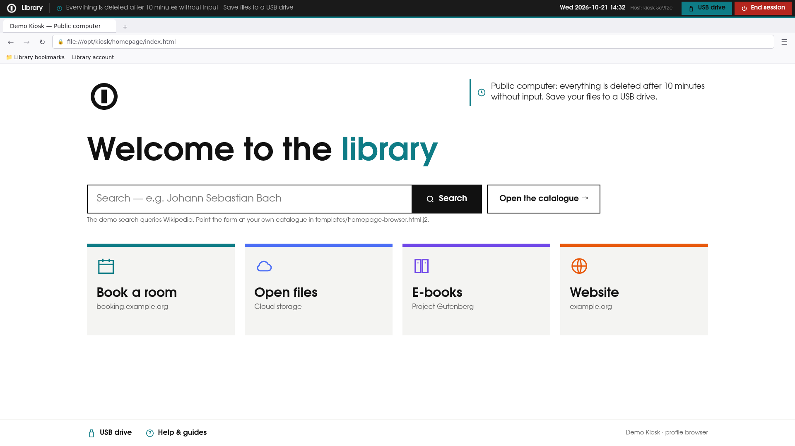
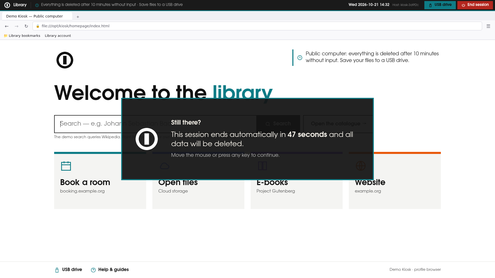
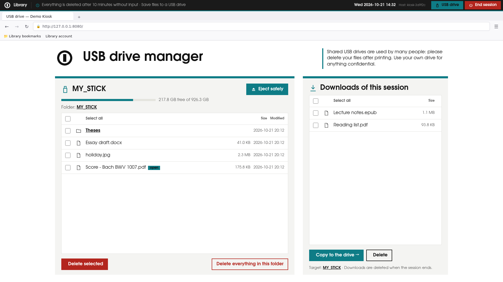
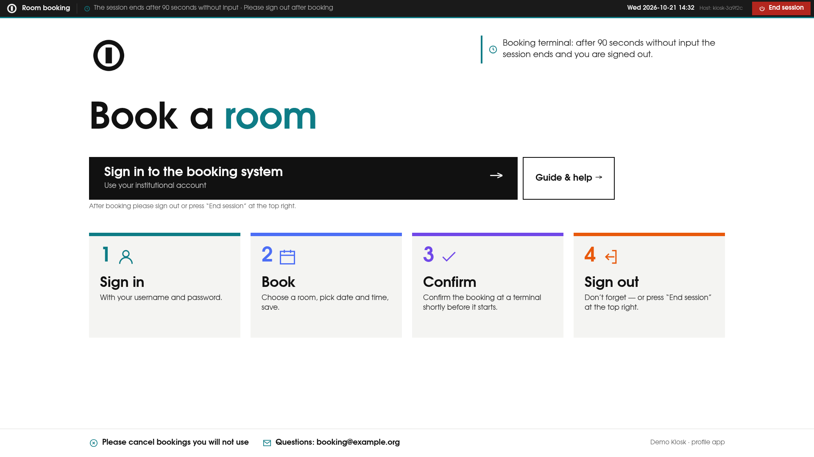
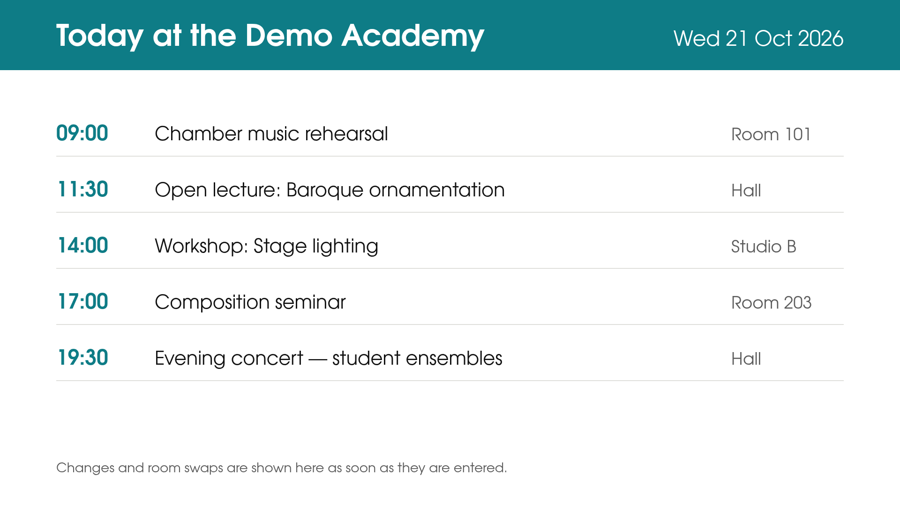
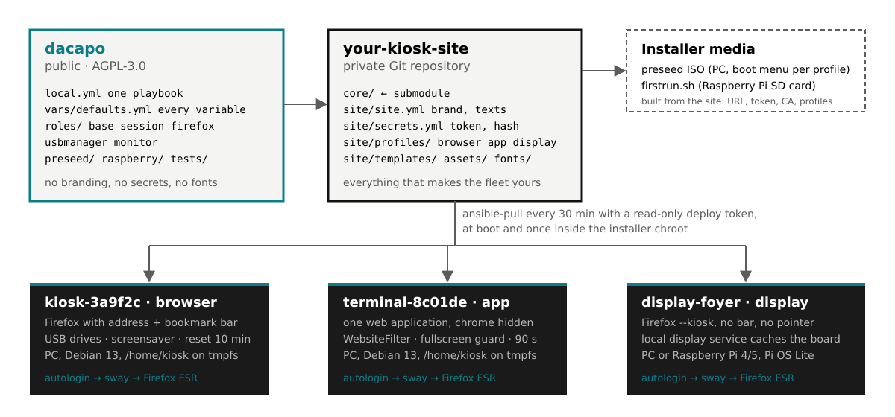

# Da capo

**Every session starts from the top.** A Debian kiosk and digital-signage toolkit for `ansible-pull`. Public
computers, web-app terminals and signage displays on one base: Debian 13 or
Raspberry Pi OS, autologin → sway → Firefox ESR with enterprise policies,
zero persistence, central maintenance from a Git repository — and everything
that makes a fleet *yours* in a separate, private site directory.

*Da capo* — "from the top": every session, and every night, the machine
starts over from a clean state.

[](https://github.com/HerrBarmann/dacapo/actions/workflows/ci.yml)
[](LICENSE)




## Why

Running a dozen unattended browsers is easy; keeping them identical, locked
down, up to date and *yours* is not. Da capo gives you:

- **One playbook, many profiles.** A device is a `browser` (public
  research computer), an `app` terminal (one web application, chrome hidden)
  or a `display` (signage, full screen, survives network outages). Profiles
  are YAML switches.
- **Zero persistence that holds.** Home on tmpfs, no swap, permanent private
  browsing, profile template per boot, idle reset with a countdown popup,
  nightly reboot.
- **Convergence instead of deployment.** Devices pull the site repository
  every 30 minutes with a read-only token. A commit reaches the fleet within
  that time; security updates install before the nightly reboot.
- **Nothing to fork.** Brand, colours, fonts, logo, every visible text,
  home pages, bookmarks, policies, hostnames and secrets live in the site
  directory. The core stays neutral and updatable as a submodule.
- **From bare metal.** One installer ISO with a boot menu for all profiles
  (or dedicated auto-install sticks) and a two-stage Raspberry Pi bootstrap,
  both generated from the site.
- **Tested.** Rendering, lint and a full playbook run per profile in a
  Debian container, twice (idempotence), in CI.

## Screens

| | |
|---|---|
|  |  |
| Idle warning: centred popup with countdown, any input cancels | USB drives from the browser: delete, copy downloads, eject |
|  |  |
| `app`: launch page, chrome hidden, only the application reachable | `display`: full screen, local service caches the board |

All screens come from the shipped demo site (free fonts, generated logo)
and are regenerated with `tools/make-screenshots.sh`.

## Architecture



```
your-kiosk-site/                 (private)          dacapo/            (public, this repo)
├── core/  ───── git submodule ──────────────────▶  ├── local.yml        one playbook for every profile
├── site/                                           ├── vars/defaults.yml  reference of all variables
│   ├── site.yml        branding, texts, timers      ├── roles/
│   ├── secrets.yml     pull URL + token, admin hash  │   ├── base      OS, users, tmpfs, timers, Wi-Fi, CA
│   ├── profiles/       browser.yml app.yml ...      │   ├── session   sway, waybar, idle popup, screensaver
│   ├── templates/      home pages (Jinja2)          │   ├── firefox   policies, profile template, extensions
│   ├── assets/ fonts/ wallpaper/                    │   ├── usbmanager  USB drives from the browser
│   └── files/          authorized_keys, ca.crt      │   └── monitor   display service for signage
└── README.md                                       ├── preseed/  raspberry/  tests/  tools/  docs/
```

Devices run `ansible-pull -U <site repo> core/local.yml` from a systemd timer.
The playbook finds the site next to itself, detects the device's **profile**
(explicit, marker file, hostname prefix or site default), layers the variables
and converges the machine — inside the installer chroot as well as on a
running system, idempotently.

## Three profile types

| `firefox_mode` | Typical use | What you get |
|---|---|---|
| `browser` | public research / library computers | Firefox with address and bookmark bar, managed bookmarks, USB drives, screensaver, idle reset with countdown popup |
| `app` | terminal for one web application | browser chrome hidden (userChrome.css), WebsiteFilter allows only the app and its login provider, fullscreen watchdog, short idle reset |
| `display` | digital signage, event boards, dashboards | Firefox `--kiosk` full screen, no bar, no pointer, local display service that caches the content and survives network outages |

A profile is a YAML file of switches: `idle_seconds`, `screensaver_enabled`,
`waybar_enabled`, `usb_enabled`, `firefox_extensions`, `firefox_policies_profile`,
`monitor_url`, `output_transform` … — see [docs/profiles.md](docs/profiles.md).
Every visible text, colour and font is a variable; nothing in the core has to
change for a new site.

## Quickstart with the demo site

Requirements on the workstation: `ansible` (≥ 2.16), `ansible-lint`, Docker
(for the container test and the ISO build). macOS works.

```bash
git clone https://github.com/HerrBarmann/dacapo.git && cd dacapo
ansible-playbook --syntax-check -i localhost, local.yml
ansible-playbook -i localhost, tests/render.yml -e profile=browser   # -> tests/out/site-demo/browser/
tests/docker-test.sh browser                                          # full run in debian:trixie, twice
```

`examples/site-demo/` is a complete, neutral site: free font (URW Gothic),
generated demo logo and wallpapers, three profiles (`browser`, `app`,
`display`), dummy placeholders for secrets. Copy it as the starting point of
your own site:

```bash
mkdir ../my-kiosk-site && cp -r examples/site-demo ../my-kiosk-site/site
cd ../my-kiosk-site && git init && git submodule add https://github.com/HerrBarmann/dacapo.git core
$EDITOR site/site.yml site/secrets.yml site/profiles/*.yml
```

Then build an installer and roll out: [docs/deployment.md](docs/deployment.md).

## Documentation

| Document | Content |
|---|---|
| [docs/site-layout.md](docs/site-layout.md) | the site directory: every file, where it is deployed, how variables layer |
| [docs/profiles.md](docs/profiles.md) | profiles and all switches, the three Firefox modes, extensions, policies, per-device overrides |
| [docs/deployment.md](docs/deployment.md) | installer ISO (PC, one ISO with boot menu or dedicated sticks), Raspberry Pi SD card, acceptance test |
| [docs/operations.md](docs/operations.md) | daily operation: what runs when, changing things, troubleshooting, hardening |
| [examples/site-demo/](examples/site-demo/) | the demo site |
| [vars/defaults.yml](vars/defaults.yml) | every variable with its default and a comment |
| [CONTRIBUTING.md](CONTRIBUTING.md), [SECURITY.md](SECURITY.md), [CHANGELOG.md](CHANGELOG.md) | contributing, reporting, releases |

## Tests and CI

```bash
ansible-lint local.yml roles/ vars/ tests/render.yml
for p in browser app display; do ansible-playbook -i localhost, tests/render.yml -e profile=$p; done
tests/docker-test.sh app          # also: browser | display; SKIP_PACKAGES=1 for a fast run
tests/idle-chain-test.sh app      # live headless session: idle warning, input, reset, screensaver
tests/compare-render.sh <expected-dir> <actual-dir> [rename-map]   # compare two renderings
```

The GitHub Actions workflow runs syntax check, ansible-lint, rendering of all
demo profiles, shellcheck, Python byte-compilation and the full container test
per profile.

## Origin

Da capo was extracted from the kiosk fleet of the Hochschule für Musik und
Theater Hamburg (library computers, booking terminals, event displays) and
generalised so that any institution can run it with its own site directory.

## Licence

GNU Affero General Public License v3.0 or later, see [LICENSE](LICENSE) and
[NOTICE](NOTICE). Please keep the attribution to Dennis Bormann ([HerrBarmann](https://github.com/HerrBarmann))
and Hochschule für Musik und Theater Hamburg, ITSC when redistributing or
running modified versions. A
private site repository that uses dacapo as a submodule and only holds
its own configuration does not have to be published. The demo logo and
wallpapers are generated and free to use; site repositories may contain
licensed material (fonts, logos) and should stay private — the core never does.
